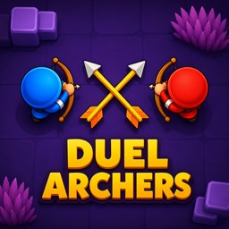
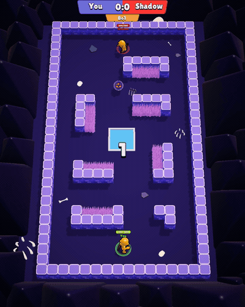
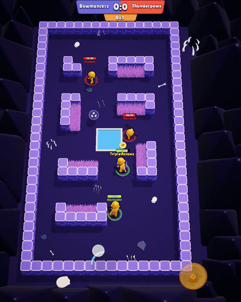
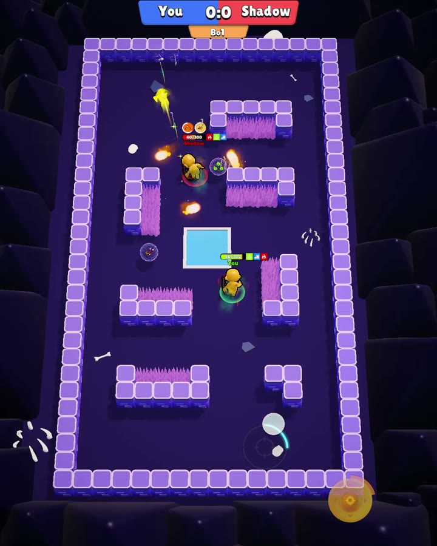
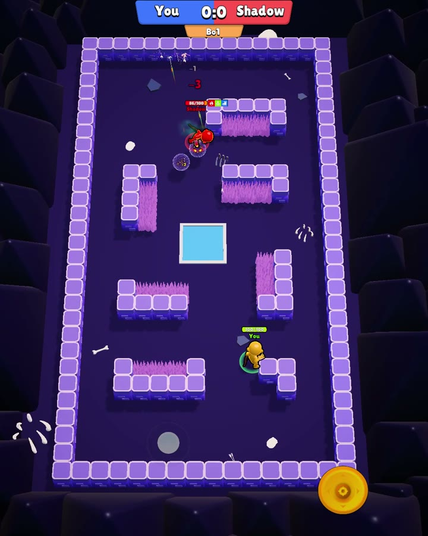
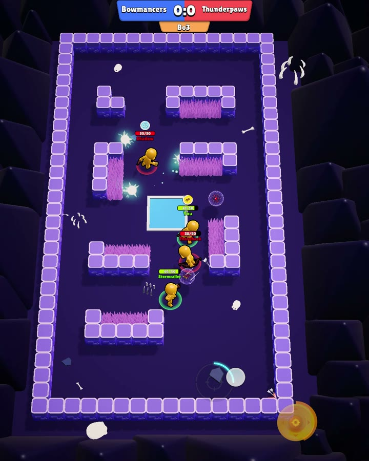
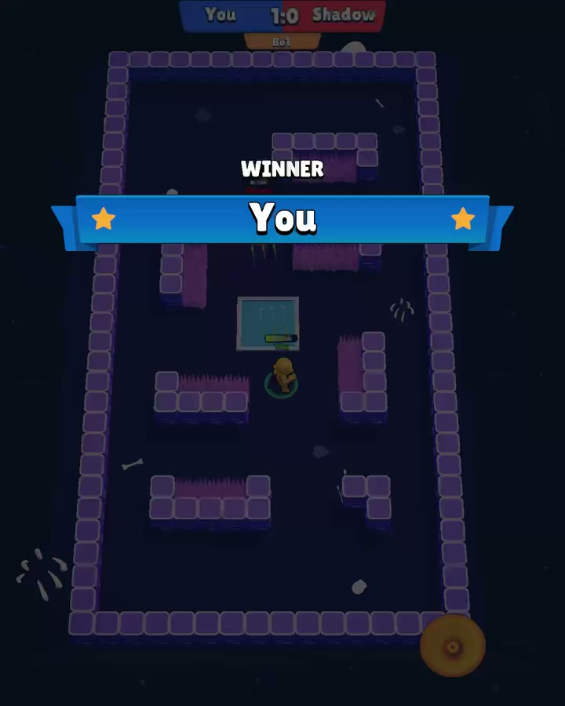

  

<h1 align="center">Duel Archers</h1>

Online PvP archer brawler for Android: 1v1 duels, plus 2v2 and 3v3 against bots.

**Role:** Team Lead & Core Developer (pet project). I led a team of 5 people, developers and non-dev roles: planning, task specs, code review.
**Period:** January 2025 – July 2026
**Stack:** Unity 6 · URP · **Photon Quantum 3** (deterministic ECS, rollback netcode) · Photon Realtime · Zenject · DOTween · Cinemachine · HyperKit SDK (Firebase, AppLovin MAX, AdMob, Adjust)

  
  &nbsp;
  

## Gameplay
Move with a joystick. When the archer stands still, it auto-shoots the nearest visible target. Before a match you pick ability cards (fire, frost and poison arrows, orbital shots, multishot, crit, vampirism) and an ultimate: a super-shot or a dash. Bushes hide players, buffs spawn on hot-spots, and a dead zone shrinks the arena.

## What I built
I worked on core architecture, gameplay features, visuals and release.

- **Multiplayer foundation.** Moved the prototype to Photon Quantum and set up the Boot scene, game state machine, scene loading and Zenject installers.
- **Zenject → Quantum DI bridge.** Quantum systems normally get no constructor injection. With my `SystemActivator` and `FeatureBase`, a feature declares a system with one `Add<T>()` call and its dependencies come from Zenject.
- **Core combat in deterministic ECS:** cooldowns, projectiles, damage and heal effects, death and cleanup, target collection, and orbiting fire, frost and poison shots.
- **Ultimate, end to end:**
  - charge accumulation in the simulation, with HUD events;
  - a second joystick for aiming, with a progress ring and aim preview;
  - the super-shot;
  - a **collision-safe dash** that moves in fixed-point substeps with raycast sweeps.
- **UI framework:** Zenject-driven windows, match intro, post-match window, and MVP modes against bots.
- **Visuals and feel:** URP migration, elemental arrow trails, dash trail, a shader-driven damage vignette, hit flashes and buff indicators.
- **Config architecture:** a typed static-data registry, with a configuration guide for game designers.
- **Release:** publisher SDK integration with deduplicated progression analytics, and a one-click release AAB build that meets Google Play's 16 KB page-size requirement for Android 16 (API 36).

## Code samples
Real code from the project, written by me.

| File | What it shows |
|---|---|
| [SystemActivator.cs](code-samples/SystemActivator.cs) + [FeatureBase.cs](code-samples/FeatureBase.cs) | Constructor injection for Photon Quantum systems from a Zenject container |
| [DashUltimateMoveSystem.cs](code-samples/DashUltimateMoveSystem.cs) | Deterministic dash: fixed-point substeps, raycast sweep with a skin margin |
| [UltimateChargeSystem.cs](code-samples/UltimateChargeSystem.cs) | Simulation-side charge that sends a HUD event only when the percent changes |

## Screenshots

  
  
  
  

▶️ [2v2 match clip (mp4)](media/duel_2v2.mp4)

---
Egor Babaev · [LinkedIn](https://www.linkedin.com/in/egor-babaev/) · babaev1302@gmail.com
